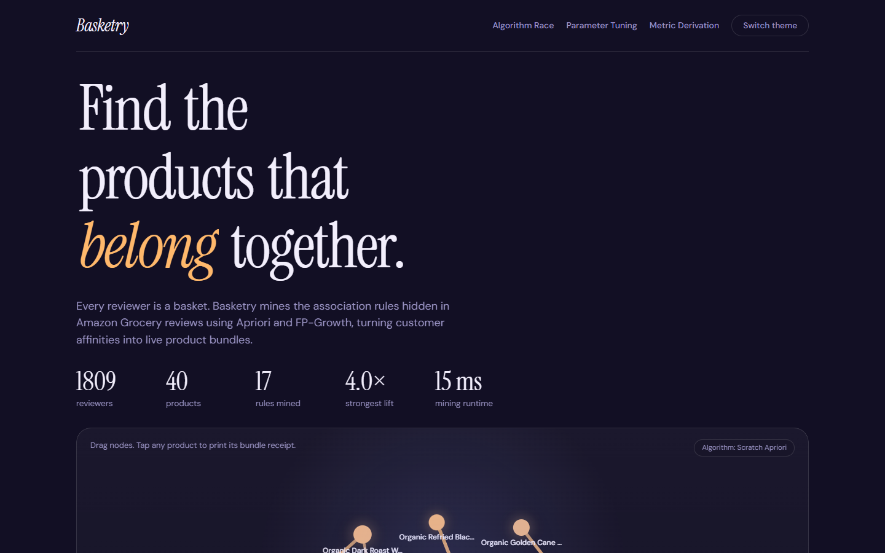
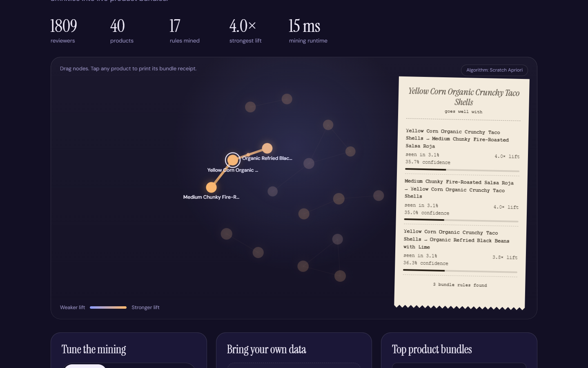
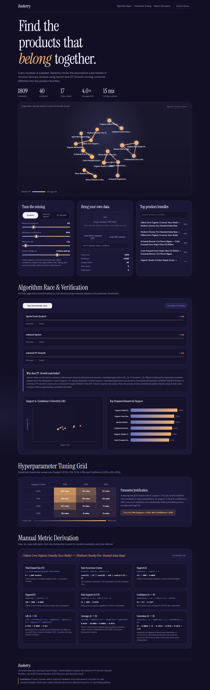

# Basketry

Market basket analysis on Amazon product reviews using association rule mining (Apriori).

Each reviewer is treated as a basket, and the products they reviewed are the items in it. The project mines frequent itemsets and association rules from these baskets and uses the strongest rules to suggest product bundles. It includes an Apriori implementation written from scratch, comparisons with `mlxtend` Apriori and FP-Growth, a Jupyter notebook for the analysis, and a small web app for trying it on your own data.

Author: Prajwal Borkar

## Screenshots

**Home page**



**Product graph.** Products are nodes sized by support. Rules are edges, with thickness and colour showing lift. Selecting a product prints its bundle rules.



**Controls, data upload and top bundles.** The sliders re-run the mining and the graph updates. A CSV can be dropped in to use other data.



## Setup

```bash
git clone https://github.com/pborkar2602-netizen/amazon-market-basket-apriori.git
cd amazon-market-basket-apriori
python -m venv .venv
source .venv/bin/activate        # Windows: .venv\Scripts\activate
pip install -r requirements.txt
uvicorn app.main:app --reload
```

Open http://localhost:8000. The app starts on `data/demo_small.csv`, so nothing needs to be downloaded. You can also upload your own CSV from the page.

To rebuild the larger sample from the original dataset:

```bash
python data/prepare_data.py
```

To run the tests:

```bash
python -m pytest -v tests/
```

## Dataset

- Source: Amazon Reviews 2023, McAuley Lab (UCSD), on Hugging Face: `McAuley-Lab/Amazon-Reviews-2023`
- Category: Grocery and Gourmet Food, 5-core subset
- `data/reviews_sample.csv`: 30,000 reviewers and 114,423 reviews, sampled with a fixed random seed by `data/prepare_data.py`
- `data/demo_small.csv`: a small subset used for the demo and the tests

Demo file after filtering:

| Item | Value |
| :--- | :--- |
| Raw rows | 7,676 |
| Raw reviewers | 2,000 |
| Baskets kept (reviewers with 2 or more products) | 1,809 |
| Unique products | 40 |
| One-hot matrix | 1,809 x 40 |

Citation for the dataset:

Hou, Y., Li, J., He, Z., Yan, A., Chen, X., McAuley, J. (2024). Bridging Language and Items for Retrieval and Recommendation. arXiv:2403.03952.

## Results on the demo data

Parameters: min_support = 0.03, min_confidence = 0.35, min_lift = 1.2, max_len = 3.

| Algorithm | Frequent itemsets | Rules | Max lift | Time in my run |
| :--- | :--- | :--- | :--- | :--- |
| Apriori from scratch | 55 | 17 | 4.033 | about 10 ms |
| mlxtend Apriori | 55 | 17 | 4.033 | about 28 ms |
| mlxtend FP-Growth | 55 | 17 | 4.033 | about 61 ms |

All three methods return the same itemsets and rules, which the tests check. The timings come from a single run on my machine. On a dataset this small (40 products), the extra overhead of the library calls matters more than the algorithm, so these numbers do not show FP-Growth's usual advantage on larger data. The notebook repeats the comparison on the 30,000 reviewer sample.

## How the parameters were chosen

At 1,809 baskets, a support of 3 percent means an itemset must appear in about 54 baskets. Lower values return many rare combinations that are probably noise on a dataset of this size. The sweep over support (0.5, 1, 2, 3 percent) and confidence (20, 40, 60 percent) is in the notebook, with rule counts for each combination and the reasoning for the final choice.

## Limitations

Reviews are not purchases. A reviewer may have bought items at different times or from different sellers, so a basket here shows which products someone reviewed, not what they bought together. The rules show which products are reviewed together, and the bundle suggestions should be read that way. Using only ratings of 4 stars and above keeps the baskets closer to products people liked.

## Project structure

```
app/
  main.py             FastAPI app, endpoints, static file serving
  apriori_scratch.py  Apriori from scratch: join, prune, count, rules
  algorithms.py       mlxtend Apriori and FP-Growth wrappers
  preprocess.py       column detection, rating filter, single-item basket removal
  metrics.py          support, confidence, lift, leverage, conviction, worked example
data/
  prepare_data.py     builds the sample files
  demo_small.csv
  reviews_sample.csv
docs/                 screenshots used in this README
static/               index.html, style.css, app.js
notebook/analysis.ipynb
reports/REPORT.md
tests/                test_apriori.py, test_api.py
```

## API

| Method | Endpoint | Purpose |
| :--- | :--- | :--- |
| POST | /api/upload | Upload a CSV and get a dataset summary |
| POST | /api/mine | Mine itemsets and rules with scratch, apriori or fpgrowth |
| GET | /api/compare | Run all three algorithms and compare results and time |
| GET | /api/recommend | Top bundles for a product, ranked by lift |
| GET | /api/sweep | Support and confidence sweep |
| GET | /api/manual-example | Worked calculation of one rule from raw counts |
| GET | /api/summary | Dataset summary |

## Where each requirement is covered

| Requirement | Location |
| :--- | :--- |
| Dataset understanding | Notebook section 1 |
| Preprocessing | `app/preprocess.py`, notebook section 2 |
| Algorithm from scratch | `app/apriori_scratch.py`, notebook section 3 |
| Modeling | `app/algorithms.py`, notebook section 4 |
| Parameter tuning | `/api/sweep`, notebook section 5 |
| Metrics and manual calculation | `app/metrics.py`, notebook section 6 |
| Comparison | `/api/compare`, notebook section 7 |
| Visualization | Notebook section 8, web app |
| Interpretation | Notebook section 9 |
| Code documentation | Comments and notebook text |
| Report | `reports/REPORT.md` |

## Tests

11 tests pass (Python 3.11.9, pytest 9.1.1, about 7 seconds). They cover the metric formulas, preprocessing, agreement between the scratch Apriori and mlxtend, and the API endpoints.

## License

MIT. See `LICENSE`.
